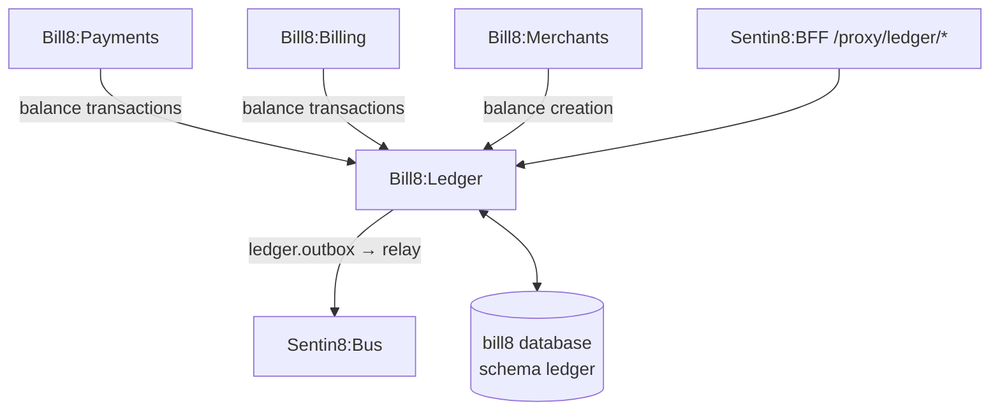

# Bill8:Ledger - Money Engine

The double-entry money engine: balances, balance transactions, payouts,
transfers, and the fee model.

## 1. Summary

Bill8:Ledger owns every money position and movement in the bill8
vertical. It is the single authority that mutates balances; every other
service moves money by asking it to post a balance transaction.

## 2. Motivation

Money integrity demands a single double-entry authority: a batch that
does not net to zero is rejected before any write, so the books can
never drift. Separating money movement from orchestration keeps the
charge lifecycle (payments) distinct from balance truth (ledger).

## 3. Architecture & High-Level Design

## 4. Key Traits and Data Structures

- `Balance` - a named money position per account (`available`, `pending`,
  `connected_reserved`, `platform_fee`).
- `BalanceTransaction` - an append-only double-entry movement debiting one
  balance and crediting another.
- `Payout` - a movement of available balance to an external account.
- `Transfer` - an internal movement between connected accounts.

## 5. Rationale, Trade-offs, and Alternatives

- **Double-entry over single-ledger rows**: single-sided writes cannot
  prove conservation; double-entry makes every batch verifiable.
- **Fee model in-ledger**: platform fees are captured as explicit
  balance transactions, so revenue is provable.
- **Rejected**: distributed multi-ledger - a single authority per
  vertical keeps atomicity simple.

## 6. Internal Implementation & Invariants

- Every batch nets to zero before commit.
- Balance transactions append-only.
- Payout state machine guarded (`pending` → `paid` / `failed`).

## 7. Unresolved Questions / Future Designs

- See `DESIGN.md` §10.

---

**Design attribution:** bill8:ledger and its underlying concepts were designed by Hamid Jahanzad <Hamid@Jahanzad.com>.
